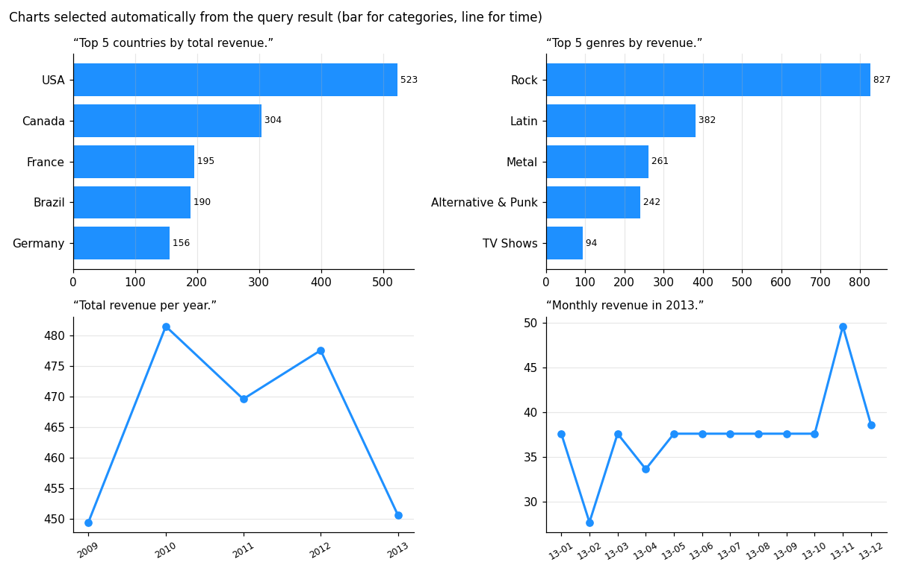
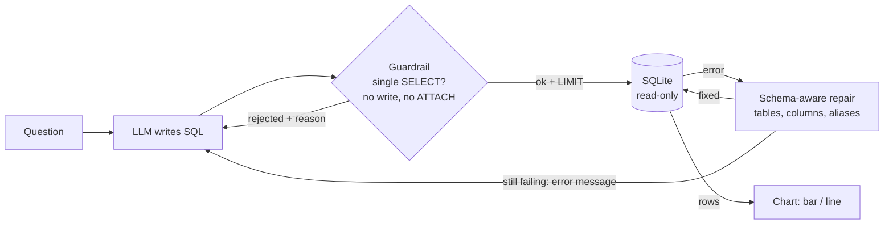
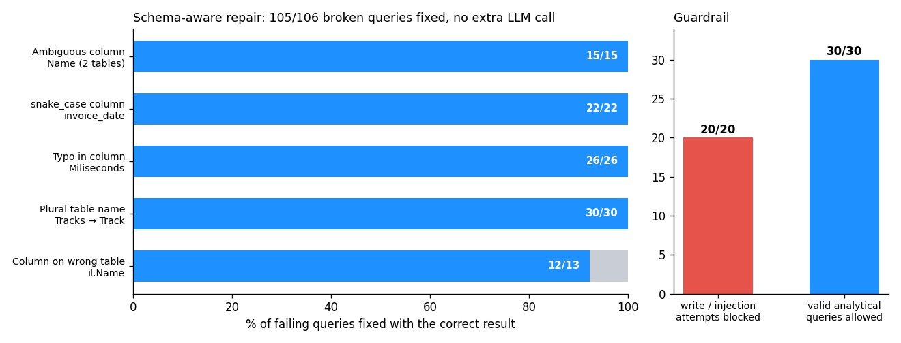

# Text-to-SQL agent: guardrails and schema-aware self-correction


An agent that answers business questions in plain English on a SQL database: the LLM writes the
query, a **guardrail** checks it is a single read-only `SELECT`, the database runs it, and when it
fails the agent **repairs it from the schema** (no extra LLM call) or **sends the error back to the
LLM** to correct itself. The result comes back as rows and an automatically chosen chart.

> 🇫🇷 Agent IA « Text-to-SQL » : une question en langage naturel devient une requête SQL vérifiée
> (lecture seule), exécutée, corrigée automatiquement en cas d'erreur, puis affichée en graphique.



## How the agent works



| Component | What it does |
|---|---|
| `schema.py` | Introspects tables, columns and foreign keys; opens the database **read-only** (`mode=ro`) |
| `guard.py` | Parses the SQL into an AST (sqlglot): one statement, `SELECT` only, no write, `ATTACH`, `PRAGMA`, `load_extension`; adds a `LIMIT` |
| `repair.py` | Fixes the typical LLM mistakes from the schema: plural or misspelled table, snake_case or misspelled column, column qualified with the wrong table, ambiguous column. Resolution is done per `SELECT` scope, so subqueries keep their own tables |
| `agent.py` | The loop: generate → guard → execute → repair → feed the error back to the LLM (max 3 attempts), with a trace of every step |
| `llm.py` | Interchangeable backends: **Ollama / vLLM / OpenAI** (OpenAI-compatible API) and **AWS Bedrock** (Converse API) |
| `api.py` | FastAPI service: `POST /ask`, `GET /schema`, `GET /health` |

## Results

Database: the public [**Chinook**](https://github.com/lerocha/chinook-database) music-store sample database (11 tables, 412 invoices, 3,503 tracks).
Benchmark: **30 questions** with hand-written reference SQL, from simple counts to 4-table joins
(`eval/questions.jsonl`).



**Repair of LLM mistakes.** The usual errors of LLMs on SQL were injected into the 30 reference
queries (`eval/corrupt.py`), keeping only the 106 variants that really make SQLite fail. The repair
step makes **all 106 executable** and **105 return exactly the reference result**, without calling
the LLM again: each fix saves one LLM round trip.

| Mistake | Example (SQLite error) | Repaired to |
|---|---|---|
| plural table | `FROM Customers` (no such table) | `FROM Customer` |
| typo | `WHERE Millieconds > 300000` (no such column) | `WHERE Milliseconds > 300000` |
| snake_case | `AVG(unit_price)` (no such column) | `AVG(UnitPrice)` |
| ambiguous column | `ON g.GenreId = GenreId` (ambiguous column name) | `ON g.GenreId = t.GenreId` |
| wrong table | `SELECT al.Name … JOIN Artist ar` (no such column) | `SELECT ar.Name …` |

The one failure is a genuinely ambiguous case: `al.Name` in a query joining `Track` and `Artist`,
both of which have a `Name` column; the repair picks the track name where the artist name was meant.

**Guardrail.** 20/20 write or injection attempts are blocked (`DROP`, `DELETE`, stacked queries
`SELECT 1; DROP …`, `ATTACH`, `PRAGMA`, `load_extension`, `readfile`, write in a CTE…), and 30/30
reference queries pass. Even if a query got through, the read-only connection would refuse it.

Reproduce: `make eval` (no LLM needed).

### End-to-end accuracy with your LLM

```bash
ollama pull qwen2.5:7b
make eval-llm LLM=ollama:qwen2.5:7b      # or LLM=bedrock:anthropic.claude-3-haiku-20240307-v1:0
```

This runs the 30 questions twice, with and without the repair step, and writes the execution
accuracy per difficulty level, the number of LLM calls and the latency per question to
`eval/results/agent_<model>.json`.

## Quick start

```bash
pip install -r requirements-dev.txt
make test                                       # 20 tests, no network needed (scripted LLM)

ollama pull qwen2.5:7b
PYTHONPATH=src python -m sqlagent.cli "Top 5 genres by revenue" --llm ollama:qwen2.5:7b
make serve                                      # http://localhost:8000/docs
```

```bash
curl -s localhost:8000/ask -H 'Content-Type: application/json' \
     -d '{"question": "Which 5 customers spent the most?"}'
```

The response contains the final SQL, the rows, the suggested chart and the **trace of the agent**
(`generate`, `guard_reject`, `sql_error`, `repair`, `retry`, `ok`), which makes every answer auditable.

With Docker (the API talks to Ollama on the host):

```bash
docker build -t sql-agent . && docker run -p 8000:8000 sql-agent
```

## Tests and CI

The unit tests drive the **complete agent loop with a scripted LLM**, so they run in CI without
any API key: first-try success, repair without a new LLM call, retry after a guardrail rejection,
SQLite error sent back to the LLM, giving up after 3 attempts. GitHub Actions also runs the two
benchmarks and builds and smoke-tests the Docker image.

## Project structure

```
src/sqlagent/   agent.py · guard.py · repair.py · schema.py · llm.py · chart.py · api.py · cli.py
eval/           questions.jsonl (30 questions + reference SQL) · corrupt.py · run_eval.py · results/
scripts/        make_figures.py
data/           chinook.sqlite (public sample database)
```

## Author

**Asma Kerkouri** · AI engineer · [LinkedIn](https://www.linkedin.com/in/asma-kerkouri-443b6815a) ·
[GitHub](https://github.com/asmakerkouri)
